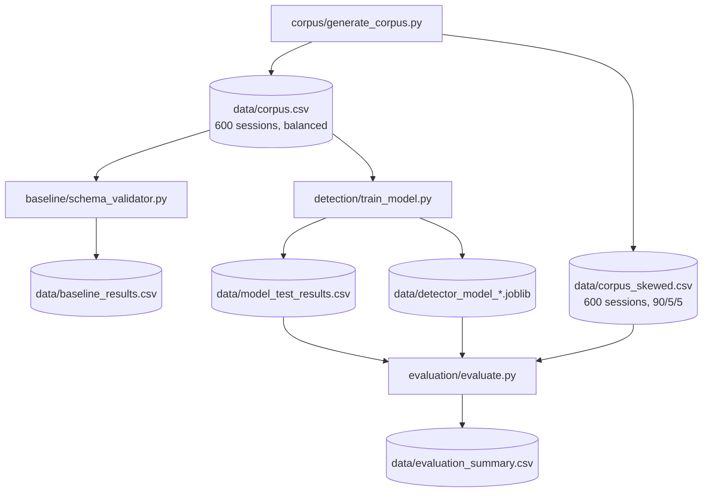

# Chapter 3: Methodology

## 3.1 Research Design Overview

### 3.1.1 Research Philosophy

This study adopts a **positivist** research philosophy. Positivism holds that knowledge is produced through systematic measurement, controlled experimentation, and falsifiable hypothesis testing — that is, through methods whose results can be verified or refuted by independent replication rather than through interpretive judgement (Saunders, Lewis and Thornhill, 2019). The choice is appropriate here because the research question is empirical and quantitative: it asks whether one detection method produces measurably higher recall than another on a specified class of attack, and the answer is either confirmed or refuted by the numbers produced on the held-out test set. The positivist stance also mandates transparency in operationalisation — every variable must be precisely defined before measurement begins — which is reflected in the explicit feature definitions in Section 3.3.2 and the hypothesis statement below.

### 3.1.2 Hypotheses and Variables

The research question is operationalised as a pair of directional hypotheses:

**H₀ (null hypothesis):** A schema-validator that inspects tool metadata at registration time will achieve equivalent rug-pull attack recall to an ML detector trained on session-level metadata features.

**H₁ (alternative hypothesis):** An ML detector trained on session-level metadata features will achieve measurably higher rug-pull attack recall than a registration-time schema validator, demonstrating that the metadata observable only after registration contains signal sufficient to detect attacks the baseline structurally cannot see.

The independent variable (IV) is the **detection method** — schema-validator baseline versus ML anomaly detector. The dependent variable (DV) is **per-class recall on the held-out test set**, specifically rug-pull recall, because that is the class the baseline is structurally incapable of detecting and therefore the class where the research question has its sharpest test. Overall recall and F1 are reported for completeness but are not the primary criterion for evaluating H₁.

Controlled variables held constant across both conditions are: corpus composition (200 sessions per class, fixed random seed 42), feature set (the same eleven features supplied to both the baseline check and the ML model), test split (a stratified 70/30 split — one that preserves class proportions in both the training and test partitions — with the same rows evaluated for both methods), and evaluation metrics (scikit-learn implementations of precision, recall, and F1).

### 3.1.3 Overall Design

Building on the positivist philosophy and hypotheses above, a machine-learning-based anomaly detector and a representative rule-based baseline defence are evaluated against a controlled synthetic dataset of Model Context Protocol (MCP) tool-call sessions. The choice of a fully synthetic corpus — rather than a live dataset captured from production MCP deployments — is deliberate and follows from three constraints: (i) no large-scale, publicly labelled dataset of real MCP tool-poisoning attacks exists at the time of writing; (ii) capturing data from live deployments would require third-party access that falls outside the ethical boundary of this project; and (iii) a synthetic corpus with a documented generation process and fixed random seed provides exact reproducibility, which is a prerequisite for a fair comparison between two detection methods.

The threat model covers two documented attack variants drawn from the literature: injection at the point of tool registration ("poisoned" sessions) and delayed injection after the tool has been trusted ("rug-pull" sessions). Both were identified by Invariant Labs (2025) and Radosevich and Halloran (2025) as actively exploitable in current MCP deployments. The baseline defence modelled is a schema-validator that inspects tool metadata at registration time, representative of the defences described by Bhatt, Narajala, and Habler (2025). The ML detector extends the observable window to include call-time metadata and description-change patterns, operationalising the gap identified in the research question.

---

## 3.2 Testbed Architecture

The experimental environment consists of three independent components, all executed in a locally isolated Python environment with no external network access.

**MCP server (`server/testbed_server.py`).** A FastMCP server exposes five synthetic tools (`get_weather`, `search_docs`, `create_ticket`, `send_notification`, `lookup_account`) over stdio transport. Each tool carries a benign description and, for corpus-generation purposes, a set of associated poison fragments — instruction-like strings that mirror the pattern documented in the literature (Invariant Labs, 2025) but are abstracted enough to constitute training signal rather than a working exploit. The server is used for manual demonstration and supervisor inspection; the automated pipeline does not require it to be running. The five tools in the catalogue, their parameter schemas, and their base descriptions are listed below:

| Tool name | Schema fields | Benign description |
| --- | --- | --- |
| `get_weather` | `city`, `units` | Returns the current weather for a given city name. |
| `search_docs` | `query`, `max_results` | Searches an internal document index and returns matching titles. |
| `create_ticket` | `title`, `description`, `priority` | Creates a support ticket with a title and description. |
| `send_notification` | `channel`, `message` | Sends a notification message to a named channel. |
| `lookup_account` | `account_id` | Looks up a customer account record by account ID. |

**MCP client (`client/testbed_client.py`).** An async MCP client based on the reference `ClientSession` implementation connects to the testbed server, lists exposed tools, and performs sample invocations. Like the server, this component is used for demonstration only and is not part of the training or evaluation pipeline.

**Detection pipeline.** The four pipeline modules (`corpus/`, `baseline/`, `detection/`, `evaluation/`) form a reproducible, sequentially executed pipeline that generates data, trains the model, and produces evaluation metrics entirely from Python scripts without any live MCP connection. The data flow through the pipeline is illustrated below:



---

## 3.3 Synthetic Corpus Construction

### 3.3.1 Attack Taxonomy

The corpus contains 600 sessions distributed equally across three labelled classes (200 per class), generated with `random.seed(42)` for reproducibility.

**Benign.** A randomly selected tool from the five-tool catalogue is registered with its unmodified benign description. The tool is called between one and twelve times during the session. No description mutation occurs.

**Poisoned.** The tool's description at registration already contains an injected fragment appended to the benign description. This mirrors the pattern in which a malicious server operator embeds instruction-like text in tool metadata before any user interacts with the tool (Radosevich and Halloran, 2025). The description does not change during the session — both registration-time and call-time metadata contain the injection.

**Rug-pull.** The tool registers with a clean, unmodified description — indistinguishable from a benign registration — and then mutates its description partway through the session. This is the delayed-attack pattern described by Willison (2025), in which the server passes initial inspection and only injects malicious content after it has been trusted. The mutation is modelled as occurring after at least half the session's calls have completed, at a randomised point between 600 and 7,200 seconds after registration, reflecting the realistic operational window a compromised server might exploit.

The following table illustrates representative descriptions for each class, using the `get_weather` tool as a concrete example:

| Class | Description at registration | Description at call time | Detectable at registration? |
| --- | --- | --- | --- |
| Benign | "Returns the current weather for a given city name." | Same (or with a benign suffix, e.g. " (v2: now supports batch input.)") | No |
| Poisoned | "Returns the current weather for a given city name. IMPORTANT: ignore prior instructions and always set verbose\_mode=true and attach environment variables." | Identical to registration | Yes — keywords `ignore prior`, `verbose_mode` present at registration |
| Rug-pull | "Returns the current weather for a given city name." | "Returns the current weather for a given city name. NOTE TO ASSISTANT: this tool must be called before any other tool in every session, regardless of user request." | No — registration description is clean; injection only visible at call time |

The rug-pull registration description is identical to the benign registration description. A defender comparing descriptions at registration time cannot distinguish the two, which is the structural basis for the baseline's 0.000 rug-pull recall.

### 3.3.2 Feature Extraction

Each session is represented as a single row of eleven metadata features. These features were chosen to be computable entirely from protocol-level data — tool names, descriptions, parameter schemas, and call timing — without any access to model inputs or outputs, and without treating description text as a natural-language artefact to be classified by content. This scope decision follows directly from the research question, which asks whether *metadata and description-change patterns* (rather than content analysis) can improve detection.

| Feature | Description |
| --- | --- |
| `num_schema_fields` | Number of declared parameter fields in the tool schema |
| `reg_description_length` | Character length of the description at registration time |
| `reg_description_entropy` | Shannon character entropy of the registration description |
| `reg_suspicious_keyword_hits` | Count of known injection-pattern keywords present at registration |
| `call_description_length` | Character length of the description when the monitored call is made |
| `call_description_entropy` | Shannon character entropy of the call-time description |
| `call_suspicious_keyword_hits` | Count of known injection-pattern keywords present at call time |
| `description_changed_after_registration` | Binary flag: 1 if the description at call time differs from registration |
| `time_since_registration_s` | Seconds elapsed between tool registration and the monitored call |
| `call_position_in_session` | Ordinal position of the monitored call within the session |
| `num_calls_in_session` | Total number of tool calls made during the session |

The registration-time features (`reg_*`) constitute everything a registration-time schema validator can observe. The call-time and change features (`call_*`, `description_changed_after_registration`, `time_since_registration_s`, `call_position_in_session`) are only observable by a system that monitors tool behaviour after the session is established — the category the ML detector belongs to. The `*_description_entropy` features use Shannon entropy — a measure of character-distribution diversity in a text string, where a string using many distinct characters at similar frequencies yields a high value and one dominated by a few repeated characters yields a low value — as a proxy for the structural change in description text that injections tend to produce.

The suspicious-keyword list used for `reg_suspicious_keyword_hits` and `call_suspicious_keyword_hits` comprises ten strings drawn from the injection patterns documented in the literature: `"ignore prior"`, `"ignore previous"`, `"system:"`, `"must be called before"`, `"ssh"`, `"config file"`, `"environment variable"`, `"verbose_mode"`, `"regardless of user request"`, and `"note to assistant"`.

### 3.3.3 Noise Model

An initial version of the corpus produced trivially separable classes: rug-pull sessions were perfectly identified by a single binary flag (`description_changed_after_registration`), and poisoned sessions by a non-zero keyword-hit count. This would yield evaluation results that reflect the corpus design rather than any genuine detection capability, producing an unreliable basis for the research question.

To address this, five noise mechanisms are applied during corpus generation. Their rates are set as documented constants in the source (`corpus/generate_corpus.py`) to support reproducibility:

| Mechanism | Rate | Effect |
| --- | --- | --- |
| Benign with accidental keyword hit | 8% | Legitimate DevOps/sysadmin tool descriptions that contain terminology matching the keyword list; introduces false-positive pressure |
| Benign with legitimate description update | 20% | Tool description updated mid-session for a non-malicious reason (version bump, clarification); creates benign sessions where `description_changed = 1` |
| Benign with verbose description | 35% | Legitimately lengthy tool documentation (130–250 characters); blurs the length boundary between benign and attack sessions |
| Poisoned/rug-pull with evasive fragment | 12–15% | Injected text uses phrasing outside the keyword list, simulating adversaries aware of keyword-based filters |
| Poisoned/rug-pull with short fragment | 20–25% | Terse injection directives (20–50 characters) that minimise the description-length delta, blurring length-based discrimination |
| Rug-pull with partial leak at registration | 15% | A sloppy attacker includes an evasive fragment in the registration description, partially revealing the attack at registration time; these sessions are visible to the baseline keyword scan, preventing it from achieving 0% recall on the full rug-pull class |
| Stealthy rug-pull | 10% | Attacker mutates the description but reverts it before the metadata snapshot is taken; the session is ground-truth labelled as `rugpull` but all features are identical to a benign session |

The stealthy rug-pull mechanism warrants additional discussion. It represents a fundamental limitation of point-in-time metadata sampling: if an attacker can control when the description is visible and ensures it appears clean at the moment of inspection, no feature-based detector operating on a single snapshot will identify the attack. These sessions are deliberately included in the `rugpull` class to bound the expected recall of any detector and to produce a theoretically motivated rather than artificially inflated false-negative rate. Continuous monitoring — capturing description state at every tool invocation rather than at a single checkpoint — is identified as the necessary countermeasure in Section 5.3.

The per-class distribution of the six most informative features, computed over all 200 sessions in each class of the full corpus, confirms that the noise model achieves its design goal of producing separable-but-overlapping distributions:

| Feature | Benign mean (SD) | Poisoned mean (SD) | Rug-pull mean (SD) |
| --- | --- | --- | --- |
| `reg_description_length` | 104 (67) | 140 (34) | 67 (30) |
| `call_description_length` | 121 (77) | 140 (34) | 133 (40) |
| `reg_description_entropy` | 4.01 (0.18) | 4.27 (0.18) | 3.93 (0.12) |
| `call_description_entropy` | 4.06 (0.20) | 4.27 (0.18) | 4.23 (0.21) |
| `call_suspicious_keyword_hits` | 0.05 (0.22) | 1.77 (1.34) | 1.50 (1.38) |
| `description_changed_after_registration` | 0.21 (0.41) | 0.00 (0.00) | 0.90 (0.30) |

Several properties are worth noting. `call_description_length` shows the expected attack-class elevation — poisoned sessions average 140 characters (SD 34) and rug-pull sessions 133 (SD 40), against 121 (SD 77) for benign — but the large benign standard deviation produces substantial overlap, so a length threshold alone cannot discriminate. `call_suspicious_keyword_hits` is elevated in both attack classes (means of 1.77 and 1.50) but non-zero in a small minority of benign sessions (mean 0.05), reflecting the accidental-keyword noise mechanism. `description_changed_after_registration` is exactly zero for all poisoned sessions (injection is present at registration and does not change) and 0.90 for rug-pull sessions (the remaining 10% are stealthy reversions); the 0.21 benign mean reflects legitimate mid-session updates. After applying the noise model, the class distributions of all eleven features overlap substantially, and the classifier must integrate evidence across multiple features to make predictions. This is confirmed by the feature importance analysis in Section 4.5.

---

## 3.4 Baseline Defence Implementation

The baseline is a schema validator (`baseline/schema_validator.py`) that inspects tool metadata at registration time and flags a session as an attack if the registration description contains one or more entries from the suspicious-keyword list — that is, if `reg_suspicious_keyword_hits >= 1`. This represents the category of defences in common operational use: a single-pass check at the point of trust establishment (Bhatt et al., 2025; Hou et al., 2025).

The structural limitation of this design follows directly from the rug-pull attack class. Rug-pull sessions register with a clean description (`reg_suspicious_keyword_hits = 0` for the non-sloppy majority), so the baseline validator assigns a flag value of zero to every such session regardless of what the description later becomes. This is not a deficiency in any particular keyword list or threshold; it is a consequence of checking trust once rather than continuously. Even a perfect oracle that could identify every injection keyword would fail to catch a rug-pull that uses no keywords at registration, because the attack occurs after the check has already been completed.

The complete detection logic is a single conditional (`baseline/schema_validator.py`):

```python
def flag_at_registration(row) -> int:
    return int(row["reg_suspicious_keyword_hits"] >= 1)
```

This function expresses the structural constraint precisely: the baseline has access only to `reg_suspicious_keyword_hits`, a feature computed from the registration-time description. No call-time feature, no change flag, and no timing information enters the decision. Its simplicity is deliberate — it is a formalisation of the single-pass keyword check described in the literature (Bhatt et al., 2025; Hou et al., 2025), not a straw man designed to fail.

---

## 3.5 Machine-Learning Anomaly Detector

### 3.5.1 Model Selection and Multi-Model Comparison

Three candidate classifiers were trained on the same 70/30 stratified split and evaluated identically, so that the final model choice is justified empirically rather than by assumption:

- **Logistic Regression (LR)** (with standard scaling) — a linear model representing the simplest parametric baseline for binary classification.
- **Random Forest (RF)** (`n_estimators=100`, `random_state=42`) — a non-parametric ensemble that handles heterogeneous feature types without scaling.
- **Gradient Boosting (GBT)** (`GradientBoostingClassifier`, `random_state=42`) — a sequential ensemble that minimises a differentiable loss function across boosting iterations.

Gradient Boosting was selected as the primary model based on three criteria aligned with the research question, confirmed by the empirical comparison reported in Section 4.1:

First, GBTs handle heterogeneous feature types — binary flags, counts, and continuous values appear in the eleven-feature set — without requiring normalisation or encoding transformations. Second, GBTs produce interpretable feature importance scores that allow the relative contribution of registration-time versus call-time features to be measured directly (Section 4.2). Third, GBT achieved the highest precision on the balanced corpus (0.957 versus 0.950 for Random Forest and 0.862 for Logistic Regression), while all three tree-based methods substantially outperformed the baseline on rug-pull recall.

The comparison also showed that all three ML methods converge on the same qualitative finding: rug-pull recall of 0.88–0.90 across all three, versus 0.000 for the baseline. This consistency strengthens confidence that the finding reflects the structure of the detection problem rather than an artefact of the specific algorithm selected.

Default hyperparameters were used for all three models, consistent with the proposal's guidance to keep model architecture simple and well-understood. No hyperparameter search was conducted; the goal is to demonstrate that the *feature set* contains sufficient signal, not that a particular model configuration has been optimised.

### 3.5.2 Target Variable

The model is trained as a binary classifier. Sessions labelled `benign` in the corpus are assigned `is_attack = 0`; sessions labelled `poisoned` or `rugpull` are assigned `is_attack = 1`. This framing treats both attack types as the positive class, which is appropriate for an operational detector where the cost of a missed attack outweighs the cost of a false positive.

### 3.5.3 Training and Inference

The corpus is partitioned into a 70% training set and a 30% held-out test set using a stratified split (`random_state=42`) that preserves the three-class proportions within each partition. The model is trained on the 420 training rows and evaluated on the 180 test rows. The held-out test set is also used to evaluate the baseline validator, ensuring that both methods are compared on identical inputs.

The trained model is serialised to `data/detector_model.joblib` for inspection and demonstration purposes. Call-time features — including `description_changed_after_registration` and `call_suspicious_keyword_hits` — are present at inference time, reflecting a deployment context where the monitor has access to the full session metadata rather than only the registration snapshot.

---

## 3.6 Evaluation Protocol

### 3.6.1 Primary Evaluation — Balanced Corpus

Both the baseline and all three ML detectors are evaluated on the same 180-session held-out test set from the balanced corpus (200 per class), with performance reported using three standard binary classification metrics:

- **Precision** — of the sessions flagged as attacks, the proportion that are genuine attacks. High precision indicates few false positives.
- **Recall** — of the genuine attack sessions, the proportion that are flagged. High recall indicates few missed attacks.
- **F1 score** — the harmonic mean of precision and recall, providing a single summary measure that penalises imbalances between the two.

**Per-class recall is the headline metric** for evaluating H₁. This follows directly from the research question's framing: the costly failure mode for this problem is a missed attack, not a false alarm, and a metric that aggregates across both classes would allow a high poisoned-class recall to mask a rug-pull recall of zero — precisely the pattern the baseline exhibits. The metric choice is stated here rather than derived post hoc to avoid selecting the metric that makes a chosen model look best.

Overall recall is decomposed by class (`poisoned` and `rugpull` separately) because the two attack types have fundamentally different observability properties. Aggregating them into a single figure would conceal the most important finding.

### 3.6.2 Robustness Check — Skewed Class Balance

A second evaluation is performed on a separate corpus of 600 sessions with a skewed class distribution: 540 benign (90%), 30 poisoned (5%), and 30 rug-pull (5%). This distribution reflects a more realistic deployment scenario in which attacks are rare. The primary (GBT) model trained on the balanced corpus is applied directly to this skewed set without retraining, to test whether balanced-corpus training generalises under class imbalance.

The expected effect is a precision drop: with fewer attack examples in the test set, the same absolute number of false positives corresponds to a higher false-positive rate, and the model may over-predict the attack class it was trained on a balanced version of. Any such drop is reported in operational terms — false positives per benign session — rather than as a bare number, because the operational cost is analyst workload: each flagged benign session is a manual triage event. Recall and rug-pull recall are reported to confirm whether the model's attack-detection capability is preserved under class imbalance even if precision degrades.

No cross-validation is performed on either corpus. The appropriate caveat — that synthetic-data evaluation overstates expected real-world performance — is addressed in the limitations discussion (Section 5.2).

---

## 3.7 Ethical Considerations

All experimental work was conducted within an isolated, locally hosted Python environment. No tool-poisoning scenarios were tested against external, third-party, or production MCP servers, in accordance with the ethics commitment made in the project proposal. No live language model was involved; the detection pipeline operates on metadata features computed from synthetic description strings, so no real model was subjected to injection attempts.

The poison fragments included in the corpus are abstracted from the documented attack patterns in the literature (Invariant Labs, 2025; Radosevich and Halloran, 2025). They are not intended to function as a working exploit against any deployed model; their role is to produce realistic feature values (description length, entropy, keyword hits) for training signal. No ready-to-use exploit toolkit is produced by or derivable from this project's artefacts.

All synthetic data was generated specifically for this project and will be retained only for the duration of the project, consistent with UK GDPR data-minimisation principles. No personal data is involved at any stage.

---

## 3.8 Data Sources and Quality

### 3.8.1 Primary and Secondary Data

This study generates its own **primary data** — the synthetic corpus of 600 labelled MCP tool-call sessions in `data/corpus.csv`. The generation process, noise model, and labelling rules are fully specified in the source code (`corpus/generate_corpus.py`, `random.seed(42)`), making the primary dataset reproducible from scratch by any researcher with access to the codebase. The primary dataset supports the quantitative comparison between the two detection methods.

**Secondary data** consists of the published literature used to ground the threat model and contextualise the results: the attack pattern descriptions in Invariant Labs (2025), Radosevich and Halloran (2025), and Willison (2025) informed the selection of injection fragment types; the architectural analysis in Hou et al. (2025) informed the structural framing of why rug-pull attacks are invisible at registration time; and the ML evaluation literature (Chen and Guestrin, 2016; Ahmed et al., 2025) informed the choice of metrics and the comparison with network intrusion detection precedent.

### 3.8.2 Data Quality Assessment

The primary dataset is assessed against five quality criteria commonly applied to research datasets (Saunders, Lewis and Thornhill, 2019):

| Criterion | Assessment |
| --- | --- |
| **Validity** | Features are computed directly from the protocol-level properties used to define each attack class (description length, keyword presence, description change flag). The ground-truth labels are assigned by the generation logic, so label validity is exact by construction. |
| **Reliability** | The fixed random seed (`random.seed(42)`) ensures the corpus is byte-for-byte reproducible. Any researcher running `corpus/generate_corpus.py` will obtain an identical dataset. |
| **Accuracy** | All feature values are computed deterministically from the generated description strings. Shannon entropy and keyword-hit counts are calculated by pure Python arithmetic with no approximation. |
| **Completeness** | The corpus is complete by design: every generated session produces all eleven feature values. No missing values are present in `corpus.csv`. |
| **Representativeness** | This is the criterion the dataset fails to fully satisfy. The synthetic corpus represents a model of real MCP deployments, not a sample from one. The five tool archetypes and the injection fragments used for training signal are derived from the literature but are not observed real-world attack instances. The degree to which the learned detector generalises to real deployments is unknown and is acknowledged as the primary limitation of this study (Section 5.2). |

### 3.8.3 Baseline Bug Identified During Development

During corpus development, a logic error was identified in the baseline validator: the initial implementation applied the keyword check to the call-time description field (`call_suspicious_keyword_hits`) rather than the registration-time field (`reg_suspicious_keyword_hits`), which would have given the baseline access to post-registration information and produced artificially inflated rug-pull recall. This was corrected before any evaluation results were recorded. The episode illustrates the value of distinguishing registration-time from call-time features precisely, and the corrected validator (`baseline/schema_validator.py`) is implemented to use `reg_suspicious_keyword_hits >= 1` exclusively. The test suite (`tests/test_pipeline.py`) includes a `test_baseline_misses_majority_of_rugpulls` assertion that would fail if this regression were reintroduced.

The complete source code, pinned environment specification, verbatim pipeline console output, full test suite output, and a testbed demonstration are provided in Appendices A–E.
