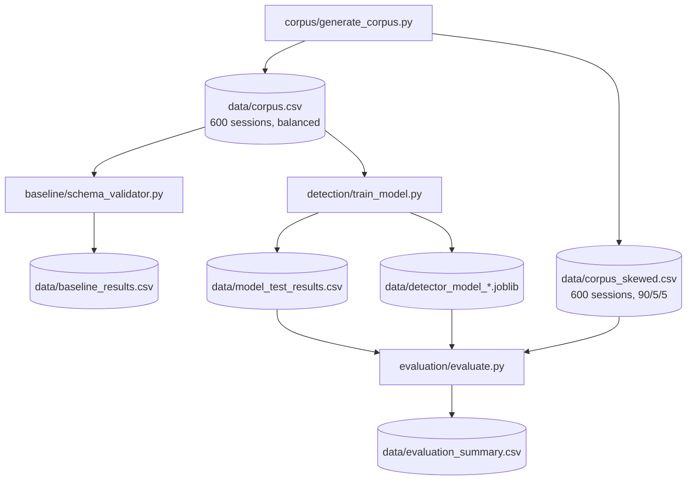

# Chapter 4: Design

## 4.1 Requirements Analysis

### Functional Requirements

| ID | Requirement |
|---|---|
| FR1 | The system shall generate a reproducible labelled corpus of MCP tool-call sessions across three defined classes: benign, poisoned, and rug-pull. |
| FR2 | The system shall implement a registration-time schema-validator baseline representative of current defences described in the literature. |
| FR3 | The system shall train and evaluate ML classifiers on session-level metadata features and compare them against the baseline on identical held-out test inputs. |
| FR4 | The system shall operate in an isolated local environment with no external network access at any stage of the pipeline. |
| FR5 | The system shall produce all evaluation outputs in machine-readable format to support independent reproducibility. |

### Non-Functional Requirements

| ID | Requirement |
|---|---|
| NFR1 | **Reproducibility** — all stochastic operations use a fixed random seed; the pipeline produces byte-for-byte identical outputs on any compliant environment. |
| NFR2 | **Isolation** — no third-party MCP servers are contacted at any stage; the testbed is entirely self-contained. |
| NFR3 | **Transparency** — noise model rates, feature definitions, and generation logic are fully documented in source code and the Methodology chapter. |
| NFR4 | **Extensibility** — the feature set and classifier selection are documented to allow straightforward replacement or augmentation in future work. |

## 4.2 System Architecture

The system is organised as a four-stage sequential pipeline illustrated below. Each stage produces output files consumed by the next; running stages out of order fails with a missing-file error, which enforces the dependency chain without additional logic.

The server (`server/testbed_server.py`) and client (`client/testbed_client.py`) are separated from the evaluation pipeline by design: they are used for manual demonstration and supervisor inspection only and are not invoked during training or evaluation. This separation ensures that the evaluation results are produced entirely from deterministic Python scripts without any live MCP connection, satisfying NFR1 and NFR2.

## 4.3 Feature Design Rationale

The eleven metadata features (defined in full in Chapter 3, §3.3.2) were selected to satisfy a deliberate scope constraint: all features must be computable from protocol-level data — tool descriptions, parameter schemas, and call timing — without access to model inputs or outputs, and without treating description text as natural language to be classified by content.

This constraint follows directly from the research question, which asks whether *metadata and description-change patterns* can improve detection. Confining the feature set to protocol-level observables produces a result that generalises across deployment contexts and avoids the data-leakage risk that arises when a text classifier is trained on the same description strings used to generate the ground-truth labels.

The most consequential design decision is the registration-time / call-time split. The four registration-time features (`reg_description_length`, `reg_description_entropy`, `reg_suspicious_keyword_hits`, `num_schema_fields`) represent everything a registration-time schema validator can observe. The remaining seven — all call-time or cross-time — are only observable by a system that monitors tool behaviour after the session is established. This split operationalises the research question as a design choice: the baseline has access to the registration-time subset only; the ML detector has access to all eleven.

One approach explicitly considered and rejected was content-based text classification — training a classifier on description text directly. This was ruled out because a text classifier trained on the same injection phrases used to assign ground-truth labels would learn the corpus vocabulary rather than the structural attack signal, producing inflated recall that would not generalise. Constraining the feature set to protocol-level metadata produces a result that is attack-variant agnostic and portable across deployment contexts.

## 4.4 Model Selection Rationale

Three classifier families were selected to ensure that any improvement in rug-pull detection is attributable to the feature set rather than to a specific algorithm. Logistic Regression provides a linear baseline; Random Forest adds non-linear ensemble capacity without sequential fitting; Gradient Boosting adds sequential error correction. The three families span the complexity spectrum from linear to ensemble methods; gradient-boosted trees demonstrate competitive performance on heterogeneous tabular data (Chen and Guestrin, 2016; Friedman, 2001).

Gradient Boosting was designated the primary model based on three properties aligned with the research question. First, it handles the heterogeneous feature types in the eleven-feature set — binary flags, counts, and continuous values — without normalisation. Second, it produces interpretable feature importance scores that allow the mechanistic contribution of registration-time versus call-time features to be measured directly. Third, it achieved the highest precision on the balanced corpus in the empirical comparison (Chapter 6, §6.2), reducing the false-alarm rate that is the primary operational cost of deployment. No hyperparameter search was conducted; demonstrating that the feature set contains sufficient signal with default parameters is a stronger scientific statement than demonstrating that a tuned model achieves high performance on a known synthetic corpus.
